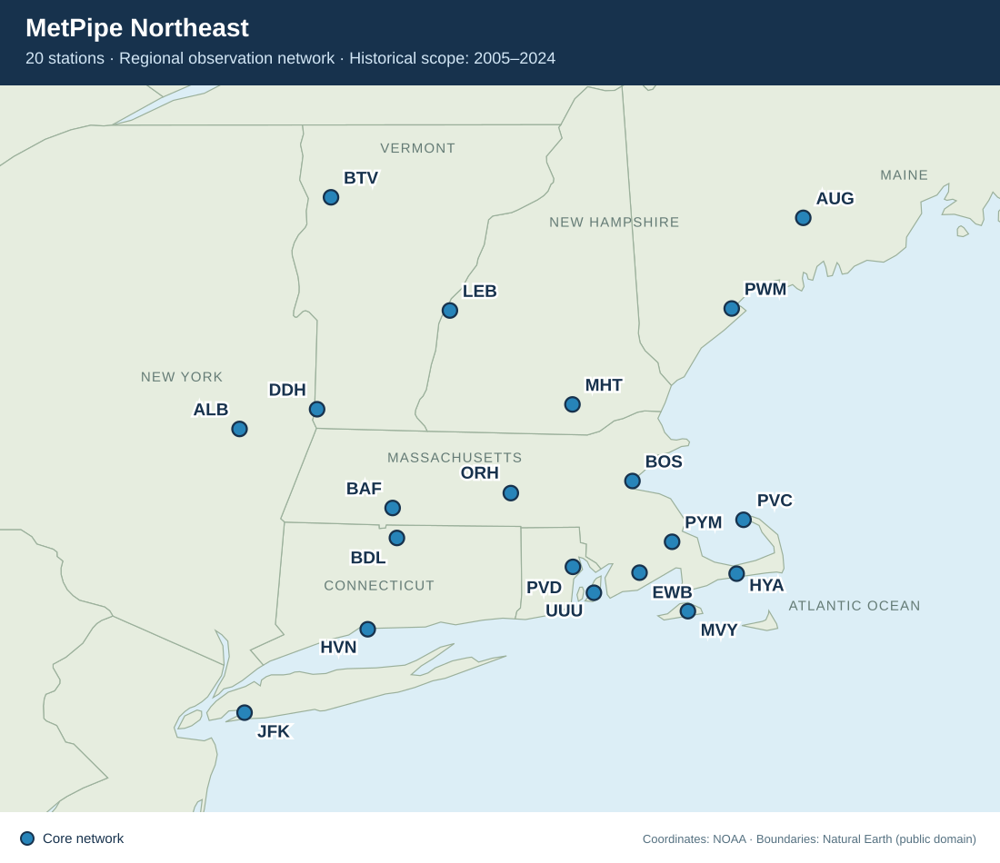

# MetPipe Northeast

**A regional weather-observation pipeline for historical analysis and future
observation-supported nowcasting in the northeastern United States.**

MetPipe turns station observations into a consistent, traceable PostgreSQL
dataset for investigating **regional weather patterns, temporal trends and
short-term changes**, including how conditions evolve across stations and
which observations may provide useful early signals for other locations.

It is intended to be used alongside **global and mesoscale numerical weather
prediction (NWP) model outputs**, supporting the development and evaluation of
statistical and machine-learning-assisted methods for local forecast refinement
and observation-supported nowcasting. Historical data provides the development
and evaluation foundation; future live-data adapters would connect that
foundation to current conditions. NWP integration and machine-learning prediction
components are planned, not yet implemented.



The network spans coastal and inland locations in MA, RI, CT, VT, NH, ME and NY.

## What it does today

- Ingests, cleans and stores multi-year NOAA airport observations with
  source-aware handling of timestamps, units, report types and quality flags.
- Provides one selected routine observation per hour, plus daily, monthly and
  annual summaries; missing observations remain missing.
- Audits station-year and element availability so analysis can account for
  gaps instead of treating file existence as complete coverage.
- Exposes UTC/SI views for future joins with live observations and model output.

The validated local database covers **20 stations, 2005–2024**: 5,381,350 point
observations and 3,495,851 selected hourly records. GHCNh supplies 2005–2019;
LCDv1 supplies the preserved 2020–2024 observations. These counts describe the
maintainer's local ingestion, not a database shipped in this repository.
Raw data and database backups are excluded from Git.

See the [ingestion report](docs/ingestion_2005_2024.md) and
[working data scope](docs/data_scope.md). Coverage and element availability vary
by station; documented gaps remain unfilled. The archive boundary at 2020 also
requires care in trend analysis.

## Where it is going

The following are **research and development goals, not implemented services**:

1. **Regional relationships and temporal evolution:** examine temperature,
   moisture, wind and pressure trends, short-term tendencies and seasonal
   variability; test station-to-station lead/lag relationships under
   different weather regimes rather than assuming a fixed travel time.
2. **Near-real-time observations:** add source-specific adapters for airport
   reports and, where suitable, mesonets, coastal/marine stations and other
   sensors, with latency, stale-data, unit and quality checks.
3. **Observation-derived diagnostics:** evaluate pressure tendency, consistently
   defined interstation pressure differences, coastal–inland contrasts and
   other physically motivated indicators.
4. **Experimental nowcasting and extrapolation:** test persistence, recent-trend
   and upstream-station baselines, then assess whether model/radar context adds
   useful skill, including through statistical and machine-learning-assisted
   forecast refinement. Planned model inputs include HRRR, GFS and ECMWF
   outputs, subject to access and consistent initialization/valid-time handling.

For example: *when a wind shift and pressure change appear at inland stations,
do they provide useful advance information for the coast—and in which
conditions does that relationship fail?* Correlation alone does not establish
propagation or forecast skill.

Pressure-index ideas such as HKO's DP972 are methodological inspiration, not
ready-made Northeast formulas. The current table stores **station pressure**;
cross-station gradients need a consistent pressure reference and explicit
treatment of elevation. See [project purpose and research roadmap](docs/project_purpose.md)
for definitions, safeguards and the evaluation plan.

MetPipe is currently a **data-engineering and weather-research foundation**,
not an operational forecasting system, warning service or validated nowcast.

## Pipeline

1. Acquire annual files through the appropriate source adapter: historical
   GHCNh UTC/SI Parquet or
   [NOAA NCEI LCDv1 CSVs](https://www.ncei.noaa.gov/data/local-climatological-data/).
2. Validate station identity, dates and source semantics; clean/convert records.
3. Create or update a non-destructive PostgreSQL schema.
4. Incrementally load observations using the source-specific loader and checkpoints.
5. Validate coverage by station and year and query daily, monthly, and annual
   summary views.

Repeated pipeline runs are idempotent at the observation level. The
`(datetime, station)` primary key and PostgreSQL upsert prevent duplicate records,
refresh corrected values, and retain previously loaded years.

## Repository layout

```text
metpipe_phase2/
├── analysis/          # Exploratory multi-year analysis and plots
│   ├── station_map.py  # Interactive airport map from NOAA CSV coordinates
│   └── export_station_map.py # GitHub-ready static map from checked coordinates
├── data/
│   ├── raw/YYYY/      # Original NOAA CSVs by year (not committed)
│   ├── raw/ghcnh/YYYY/ # Historical UTC/SI Parquet sources (not committed)
│   ├── backups/       # Local pre-ingestion database backup (not committed)
│   └── processed/YYYY/ # Cleaned CSVs by year (not committed)
├── docs/
│   ├── assets/        # Versioned README station map
│   ├── project_purpose.md # Scientific intent and development roadmap
│   └── aws/           # Local AWS reference artifacts (not committed)
├── sql/
│   ├── schema.sql     # Multi-year tables, indexes, and views
│   ├── checks.sql     # Multi-year validation queries
│   ├── backfill_checks.sql # Historical source/time/unit validation
│   └── legacy/        # Superseded 2024-only manual ingestion SQL
├── src/
│   ├── file_utils.py  # Station-year filename parsing and discovery
│   ├── main.py        # Schema and ingestion orchestrator
│   ├── ingest.py      # Incremental cleaned-data loader
│   ├── ghcnh_backfill.py # Source-aware historical adapter and checkpoints
│   ├── audit_station_minutes.py # Hourly minute and coverage audit
│   └── weather_data_cleanup.py
├── tests/             # Standard-library unit tests
├── .env.example
└── requirements.txt
```

## Requirements

- Python 3.10+
- PostgreSQL
- Packages in `requirements.txt`

Create a virtual environment and install dependencies:

```bash
python3 -m venv .venv
source .venv/bin/activate
python3 -m pip install -r requirements.txt
```

Create the default local database:

```bash
createdb metpipe_northeast
```

Connection settings can be overridden with environment variables:

| Variable | Default |
| --- | --- |
| `DB_HOST` | `localhost` |
| `DB_PORT` | `5432` |
| `DB_NAME` | `metpipe_northeast` |
| `DB_USER` | Current operating-system user |
| `DB_PASSWORD` | No password |

`.env.example` documents these variables, but the scripts do not automatically
load a `.env` file. Export overrides in the shell before running the pipeline.

## Input naming convention

Put one station and one calendar year in each raw CSV:

```text
data/raw/<year>/<station>_hourly_<year>.csv
```

Examples:

```text
data/raw/2020/bos_hourly_2020.csv
data/raw/2024/bos_hourly_2024.csv
data/raw/2025/bos_hourly_2025.csv
data/raw/2024/pvc_hourly_2024.csv
```

The cleaner produces corresponding files such as
`data/processed/2025/bos_hourly_2025_cleaned.csv`. Flat files directly in
`data/raw/` or `data/processed/` are also accepted for older datasets. A
station-year must appear only once; duplicate files and files placed under the
wrong year folder cause an error. A CSV containing multiple calendar years must
be split before cleaning. All matching years are loaded into the same database
table, so adding an older or newer year never requires concatenating CSVs.

The cleaner expects legacy NOAA LCDv1 columns, including `DATE` and
`HourlyDryBulbTemperature`. The 2020–2024 files are in US customary units
(temperature in °F, precipitation in inches, wind speed in mph, and station
pressure in inHg). LCDv2 bulk CSVs use metric units and require explicit
conversion before mixing them with these records.

## Twenty-station network

There are 100 raw station-year CSVs locally. The original 2024 ALB, BOS, JFK,
and PVD files came from the earlier NOAA download; the other 96 files came
from the LCDv1 bulk archive. The archive URL format is
`https://www.ncei.noaa.gov/data/local-climatological-data/access/<year>/<LCDv1 ID>.csv`.
For example, Boston Logan 2024 is
[72509014739.csv](https://www.ncei.noaa.gov/data/local-climatological-data/access/2024/72509014739.csv).

| Code | Station | GHCN ID | LCDv1 ID | Checked hourly minute |
| --- | --- | --- | --- | --- |
| ALB | Albany International Airport, NY | USW00014735 | 72518014735 | :51 |
| BOS | Boston Logan International Airport, MA | USW00014739 | 72509014739 | :54 |
| JFK | John F. Kennedy International Airport, NY | USW00094789 | 74486094789 | :51 |
| PVD | Rhode Island T. F. Green International Airport, RI | USW00014765 | 72507014765 | :51 |
| PVC | Provincetown Municipal Airport, MA | USW00064708 | 72507364708 | :56 |
| ORH | Worcester Regional Airport, MA | USW00094746 | 72510094746 | :54 |
| BDL | Bradley International Airport, CT | USW00014740 | 72508014740 | :51 |
| PWM | Portland International Jetport, ME | USW00014764 | 72606014764 | :51 |
| BTV | Burlington International Airport, VT | USW00014742 | 72617014742 | :54 |
| MHT | Manchester Boston Regional Airport, NH | USW00014710 | 74394514710 | :53 |
| AUG | Augusta State Airport, ME | USW00014605 | 72618514605 | :53 |
| BAF | Westfield-Barnes Regional Airport, MA | USW00014775 | 74491514775 | :53 |
| DDH | Bennington William H. Morse State Airport, VT | USW00054781 | 72616654781 | :54 |
| EWB | New Bedford Regional Airport, MA | USW00094726 | 72506594726 | :53 |
| HVN | Tweed-New Haven Airport, CT | USW00014758 | 72504514758 | :53 |
| HYA | Cape Cod Gateway Airport (Hyannis), MA | USW00094720 | 72506794720 | :56 |
| LEB | Lebanon Municipal Airport, NH | USW00094765 | 72611694765 | :53 |
| MVY | Martha's Vineyard Airport, MA | USW00094724 | 72506694724 | :53 |
| PYM | Plymouth Municipal Airport, MA | USW00054769 | 72506454769 | :52 |
| UUU | Newport State Airport, RI | USW00014787 | 72507914787 | :53 |

The minute values were checked from regular `FM-15` reports separately for
every year of **2020–2024**, not imposed on the historical backfill.
Scheduled-minute hourly coverage varies by station and year. Missing hours
remain missing in the hourly view; station-specific limitations are documented
in the [ingestion report](docs/ingestion_2005_2024.md).

## Usage

Clean every discovered raw station-year file:

```bash
python3 src/weather_data_cleanup.py
```

Create or update the schema and incrementally ingest every cleaned file:

```bash
python3 src/main.py
```

Run database validation:

```bash
psql -d metpipe_northeast -f sql/checks.sql
psql -d metpipe_northeast -f sql/backfill_checks.sql
.venv/bin/python analysis/validate_backfill.py
```

Backfill historical GHCNh data (inclusive local-standard-time years):

```bash
python3 src/ghcnh_backfill.py --start 2005 --end 2019
```

This dedicated adapter requires network access and `pyarrow`. It caches annual
Parquet files, converts UTC/SI to the legacy table's fixed UTC-5/customary units,
and preserves UTC, raw values, element-level source/QC flags and coded clouds.
It downloads the next UTC year for the five-hour local-year boundary halo.
The adapter is deliberately restricted to 2005–2019 and cannot overwrite LCDv1
rows. The legacy CSV loader also cannot overwrite GHCNh rows. Completed
station/source-year files have SHA-256 checkpoints; repeat runs do not insert
duplicates. Known failed QC values are masked, but unknown/not-checked flags
remain explicit and should be screened for each analysis.

Run unit tests:

```bash
python3 -m unittest discover -s tests -v
```

Generate and open an interactive map of the local station network:

```bash
python3 analysis/station_map.py
open outputs/station_map.html
python3 analysis/export_station_map.py
```

The interactive map reads each station's name and coordinates from its newest
local raw CSV that contains those fields, falling back to the versioned
`analysis/assets/station_network.json` when raw data is absent. The static README
map uses that same checked coordinate snapshot and can be regenerated offline
without a database or private datasets. The original four 2024 order downloads omit
coordinates, so the script uses their 2023 bulk files. All 20 confirmed stations
now have local files and appear as equal circles. Future additions in
`analysis/candidate_stations.csv` appear as
hollow diamonds until their raw files are added. Historical report availability
is checked separately from field completeness and database ingestion.
Candidate coordinates were sourced from NOAA's
[LCDv2 station list](https://www.ncei.noaa.gov/oa/local-climatological-data/v2/doc/lcdv2-station-list.txt),
with New Bedford and Bennington checked against their LCDv1 files.
The generated HTML is self-contained: it uses bundled
[Natural Earth](https://www.naturalearthdata.com/about/) public-domain
boundaries and does not request map tiles or require internet access.

## Database objects

Tables:

- `station_metadata`
- `weather_observations`
- `ghcnh_ingestion_files` — historical file checkpoints and provenance

Views:

- `weather_hourly`
- `weather_hourly_utc` — UTC timestamps and SI units for model/real-time joins
- `weather_daily_summary`
- `weather_monthly_summary`
- `weather_annual_summary`

The monthly view uses a full month date such as `2025-01-01`, preventing
January observations from different years from being combined.

For LCDv1, `weather_hourly` selects only regular NOAA `FM-15` reports at the
representative minute stored in `station_metadata`. For GHCNh, it selects a
routine report per hour using report priority, core-element completeness and
the latest routine observation, without imposing a modern fixed minute on
historical schedules. Specials cannot fill missing routine hours. The
`observation_datetime` field retains the actual time rather than the hourly
bucket. Audit legacy raw CSVs before loading new years:

```bash
python3 src/audit_station_minutes.py
```

The audit uses `FM-15` reports to show the dominant minute and the exact-minute
hourly coverage for each station-year. The 2020–2024 archive files have stable
minutes for each of the twenty stations; the checked values are seeded in
`sql/schema.sql`. Ingestion stops if a new file's dominant minute differs from
the stored value. A future reporting-schedule change needs an explicit review
and a year-aware metadata update.

GHCNh precipitation is conservative: only scheduled METAR hourly values enter
the primary amount column. Trace amounts are zero with a separate trace flag;
blanks are unknown, not dry hours. Accumulations and special-report values
remain in provenance rather than being added as hourly totals. Existing LCDv1
trace handling is preserved, not retroactively reinterpreted. Summary-view
precipitation totals are sums of available amounts, not certified complete
rainfall totals. Coded GHCNh cloud fields are retained but not fully decoded.

## Migrating from the original 2024 schema

The original `northeast_weather_2024` objects are not modified or deleted. The
recommended migration is to create the new `metpipe_northeast` database and run
the pipeline against the existing cleaned CSVs. This rebuilds the data in the
generic schema while preserving the old Phase 2 database as a reference.

## Data and credentials

CSV datasets, local environment files, generated plots, virtual environments,
and AWS reference PDFs are excluded from Git. Never commit database credentials
or private SSH keys.
