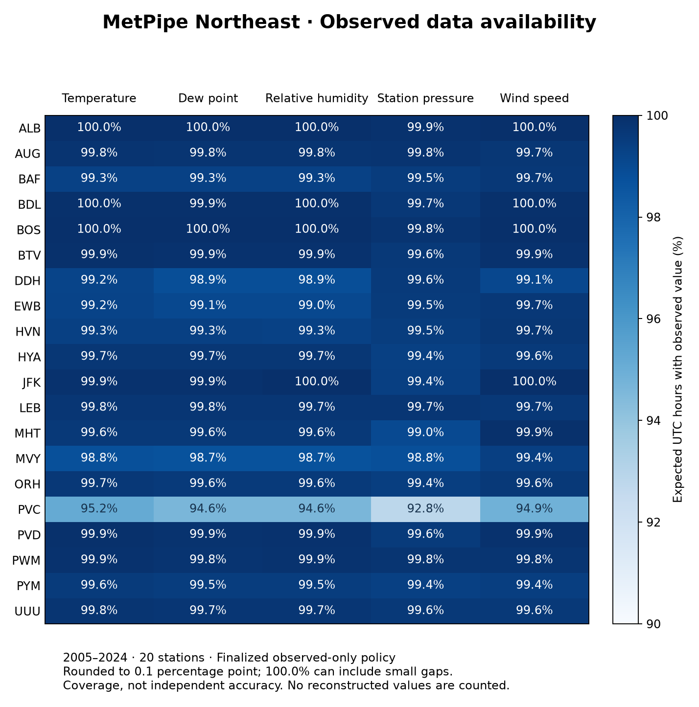

# MetPipe Northeast

MetPipe is a data pipeline that extracts weather observations from NOAA archives, standardizes and validates the data, 
and loads consistent hourly records into PostgreSQL.

It handles the less glamorous part of weather analysis: inconsistent files,
changing report times, unit conversions, quality flags and missing records. It
builds an observed-only dataset that other projects can query without repeating
that cleanup.

The current dataset covers **20 stations across seven northeastern states,
2005–2024**. The finalized layer contains **3,506,400 station-hour rows**, including
hours with missing values. Data and database backups are not included in Git.


## What the pipeline does

- Loads annual LCDv1 CSV and GHCNh Parquet files without combining years by hand.
- Checks station identity, timestamps, report types, units and source quality flags.
- Uses incremental loads and file hashes to avoid duplicate ingestion.
- Preserves both archives, then selects a value for each element and hour.
- Exposes UTC/SI observations with source and timestamp provenance.
- Reports availability by station, year and element.

The finalized policy prefers eligible GHCNh values. LCDv1 can supply a missing
value or a verified fallback; it does not automatically override a known-bad
primary value. Unresolved disagreements leave the affected element blank, not
the whole hour. See [source selection](docs/finalized_observations.md).

**Observed values stay separate from estimates.** Reconstruction models and
weather-pattern analysis now belong to companion projects, not this pipeline.

## Data availability



Availability is the share of expected UTC hours with an accepted finalized value.
It measures coverage, not independent measurement accuracy. The twenty-year
average can hide outages; the [year-by-year pressure chart](docs/assets/pressure_availability_by_year.png)
and [full availability report](docs/data_quality.md) show that detail.

Missing precipitation is not a dry hour. Gusts are only reported when applicable,
and calm/variable wind states are separate from numeric direction.

## Quick start

Requires Python 3.10+ and PostgreSQL.

```bash
python3 -m venv .venv
source .venv/bin/activate
pip install -r requirements.txt
createdb metpipe_northeast
```

Connection variables are `DB_HOST`, `DB_PORT`, `DB_NAME`, `DB_USER` and
`DB_PASSWORD`; defaults are documented in [.env.example](.env.example).
The scripts do not load `.env` automatically—export overrides in your shell.

Place one station and one year in each LCDv1 input:

```text
data/raw/2024/bos_hourly_2024.csv
data/raw/2024/pvd_hourly_2024.csv
```

```bash
python src/weather_data_cleanup.py
python src/main.py
psql -d metpipe_northeast -f sql/checks.sql
```

Historical GHCNh backfill, archive reconciliation and the complete setup sequence
are covered in [the pipeline guide](docs/pipeline.md). Database publication is
explicit; the reconciliation scripts require `--publish`.

## Query the result

```sql
SELECT station, hour_utc, temperature_c, station_pressure_hpa
FROM metpipe_final.weather_hourly_utc
WHERE hour_utc >= '2024-01-01T00:00Z'
  AND hour_utc <  '2025-01-01T00:00Z'
ORDER BY station, hour_utc;
```

Use the finalized view for new observed-data work. Older `public` views retain
their original units and fixed UTC−5 convention; they are not interchangeable
with UTC/SI fields.

## Explore and test

Start with [the data-quality notebook](notebooks/01_data_quality.ipynb). Its saved
tables and figures work on GitHub without a running database.

```bash
pip install -r requirements-eda.txt
python -m unittest discover -s tests -v
python analysis/export_station_map.py
```

```text
src/          Source adapters, cleaning and ingestion
sql/          Schemas, migrations and validation queries
analysis/     Source reconciliation, audits and station maps
notebooks/    Data-quality walkthrough
reports/      Small, versioned availability summaries
docs/         Setup, data contract and technical references
tests/        Ingestion, selection, timing and missingness checks
```

## Built on MetPipe

| Companion project | Question |
| --- | --- |
| **MetPipe Reconstruction** | Can nearby observations recover useful PVC pressure estimates without overwriting measured values? |
| **MetPipe Regional Analysis** | How do regional and temporal patterns vary, which event-timing relationships hold up, and can useful pressure indices be defined? |

The companions are separate local repositories; their GitHub links will be added
when published. They own the models, validation and scientific interpretation.
This repository owns ingestion, transformation, provenance and data quality.

A possible next application is weather-informed **ISO New England load
forecasting**: join regional weather features to load and calendar data, then
compare against simple demand baselines. ISO-NE publishes
[load data](https://www.iso-ne.com/isoexpress/web/reports/load-and-demand/-/tree/demand-by-zone)
and [forecast materials](https://www.iso-ne.com/system-planning/system-forecasting/load-forecast).
No load forecast, ISO integration or energy-market model is implemented here.
