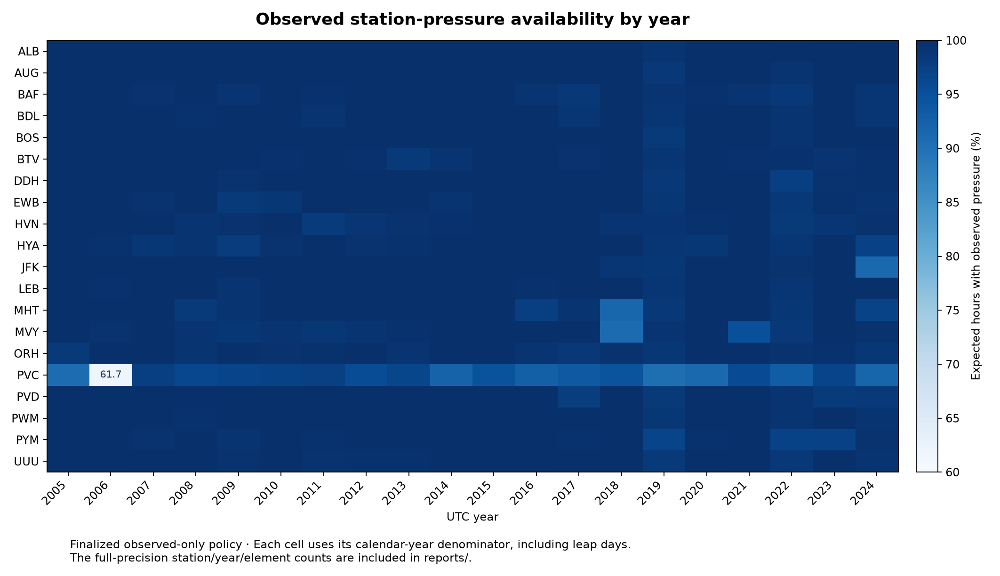

# Data quality and coverage

The committed summaries describe the finalized **observed-only** policy
`observed_2005_2024_v1`, audited October 14, 2026. They cover 20 stations,
400 station-years and 3,506,400 expected UTC station-hours.

- [Station / element table](../reports/data_availability.csv)
- [Station / year / element table](../reports/station_year_availability.csv)
- [Data-quality notebook](../notebooks/01_data_quality.ipynb)
- [Original audit record](finalized_availability.md)

Most station-element aggregates are near complete, but individual years matter.
PVC station pressure is present for 92.79% of expected hours; its 2006 coverage
is 61.75%. These gaps motivate the separate reconstruction project. No model
estimate is included in the coverage figures here.

The percentage denominator includes leap days and absent reports. A blank
precipitation field is unknown, not zero. Conditional gust reporting and valid
calm/variable wind states need different interpretations from a continuous field
such as temperature. Reported MSLP and station pressure are different elements.

Coverage does not establish measurement accuracy or a homogeneous climate record.
Source/QC flags, historical IDs, reporting schedules and archive changes remain
part of the data contract.
